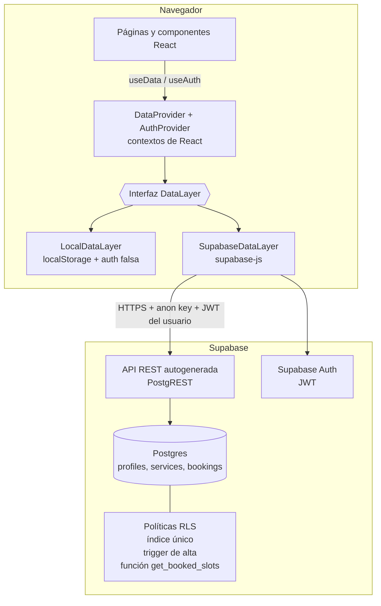
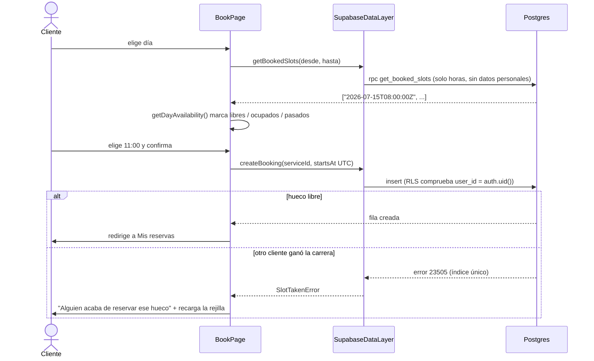

# APRENDIZAJE - Guía de estudio de SlotBook

Este documento es para ti, Yoel. El README está en inglés y es para clientes; este está en
español y es para que entiendas cada pieza del proyecto lo bastante bien como para
explicarla en una llamada con un cliente, defenderla en una entrevista y repetirla en un
proyecto real de Fiverr.

Índice:

1. Qué es este proyecto y qué demuestra
2. Arquitectura
3. Tecnologías: qué es cada una y por qué está aquí
4. Recorrido por carpetas y archivos clave
5. Cómo ejecutarlo paso a paso
6. Los 6 bugs, explicados para aprender
7. Orden de estudio recomendado (viniendo de Angular)
8. Ejercicios propuestos
9. Documentación oficial
10. Cómo contarlo a un cliente

---

## 1. Qué es este proyecto y qué demuestra

SlotBook es una app de reservas para una peluquería ficticia de Madrid (Studio Lumen). Tiene
registro e inicio de sesión, catálogo de servicios, reserva de huecos sin doble reserva,
"Mis reservas" con cancelación y un panel de administración.

Lo importante es la historia: simula la app que un cliente ha generado con Lovable y que
falla en producción. Tu trabajo (y lo que vendes en Fiverr) es:

1. Auditar: encontrar los fallos reales, no solo los visibles.
2. Arreglarlos en el sitio correcto (casi siempre la base de datos, no el frontend).
3. Demostrar que están arreglados (tests, scripts de verificación).
4. Desplegar y documentar para el cliente.

El documento `docs/BEFORE_AFTER.md` es el "informe al cliente". Este documento es la
explicación "para ti".

---

## 2. Arquitectura

### Vista general



Si tu visor no pinta Mermaid, la misma idea en texto:

```
Páginas React
   │  useData() / useAuth()
   ▼
DataLayer (interfaz TypeScript)
   ├── LocalDataLayer     -> localStorage (modo demo, sin backend)
   └── SupabaseDataLayer  -> supabase-js -> API REST de Supabase -> Postgres (+ RLS)
```

### Ideas clave de la arquitectura

- **La interfaz `DataLayer` es un contrato.** Las páginas solo conocen la interfaz, nunca
  Supabase. Es el mismo principio que inyectar un servicio abstracto en Angular. Gracias a
  eso la app funciona sin backend (modo `local`) y los tests no necesitan red.
- **La seguridad vive en la base de datos.** El frontend es código que el usuario puede
  modificar. Solo Postgres (con RLS, restricciones e índices) puede imponer reglas de verdad.
- **El tiempo se guarda como instante absoluto (UTC)** y solo se convierte a hora de Madrid
  al mostrarlo.

### Flujo de una reserva



---

## 3. Tecnologías: qué es cada una y por qué está aquí

| Tecnología | Qué es | Por qué en este proyecto |
|------------|--------|--------------------------|
| **React 18** | Librería para construir interfaces con componentes y estado | Es lo que genera Lovable. Si vendes "arreglo apps de Lovable", necesitas dominarlo |
| **TypeScript** | JavaScript con tipos | Ya lo conoces de Angular. Aquí tipa los datos (`Booking`, `Service`) y la interfaz `DataLayer` |
| **Vite** | Servidor de desarrollo y empaquetador | Arranque instantáneo; Lovable y Bolt lo usan. Equivale al `ng serve` / `ng build` |
| **React Router 7** | Enrutado en el navegador | Equivale al `RouterModule` de Angular. Es la causa del bug E si el hosting no está configurado |
| **Tailwind CSS 4** | CSS con clases de utilidad (`px-4`, `bg-teal-700`) | Estilo por defecto de Lovable. Se configura en `src/index.css` con `@import 'tailwindcss'` |
| **lucide-react** | Iconos SVG como componentes | Los mismos iconos que usa Lovable (vía shadcn/ui) |
| **Supabase** | Backend como servicio: Postgres + Auth + API REST automática + almacenamiento | El backend que usan Lovable, Bolt y Base44. Tu nicho |
| **@supabase/supabase-js** | Cliente JS de Supabase | Hace login, consultas, inserciones y llamadas RPC |
| **Postgres + RLS** | Base de datos relacional; Row Level Security filtra filas por usuario | Es donde se arreglan de verdad los bugs A, C y F |
| **Vitest** | Framework de tests compatible con Vite | Equivale a Jasmine/Karma (o Jest) en Angular, pero mucho más rápido |
| **Testing Library** | Utilidades para testear componentes como los usa una persona | Busca por rol y texto ("botón Confirm booking"), no por clases CSS |
| **jsdom** | Simulación del DOM en Node | Permite renderizar React en los tests sin navegador |
| **Playwright** | Automatiza un navegador real | Lo usamos solo para generar capturas del README con Edge |
| **Docker** | Contenedores | Para levantar Postgres en `verify:db` y el stack completo de Supabase en local |

Por qué no hay librería de fechas (date-fns, dayjs): la API `Intl` del navegador ya sabe
convertir entre zonas horarias. Menos dependencias, menos superficie de fallo. Lo verás en
`src/lib/slots.ts`.

Por qué no hay shadcn/ui: para una app de este tamaño, cinco componentes propios en
`src/components/ui.tsx` son más fáciles de leer. En un proyecto real de Lovable te
encontrarás `src/components/ui/*` de shadcn; funcionan igual (componentes + Tailwind).

---

## 4. Recorrido por carpetas y archivos clave

Lee los archivos en este orden. Entre paréntesis, qué buscar en cada uno.

### Raíz

- `package.json` (scripts: `dev`, `build`, `test`, `verify:db`, `screenshots`; versiones fijadas sin `^`)
- `vite.config.ts` (plugins de React y Tailwind; configuración de Vitest; fuerza `VITE_DATA_MODE=local` en tests)
- `tsconfig.json` (modo estricto; `noEmit` porque Vite compila y `tsc` solo comprueba tipos)
- `.env.example` (variables que el cliente debe rellenar; por qué nunca la service_role)
- `vercel.json` y `public/_redirects` (bug E)

### `src/lib` - lógica pura, sin React

- `types.ts`: los modelos (`Profile`, `Service`, `Booking`, `Session`). Equivale a tus interfaces de modelo en Angular.
- `salon.ts`: reglas de negocio (horario, zona horaria, comida, domingos cerrado).
- `slots.ts`: **el archivo más importante para entender el bug F**. Genera huecos, convierte "10:00 en Madrid" a UTC, calcula disponibilidad y valida huecos.
- `format.ts`: formatea precios y fechas siempre en hora de Madrid.
- `supabaseClient.ts`: crea el cliente de Supabase y bloquea claves secretas (bug D).
- `useAsync.ts`: un *custom hook* que carga datos y gestiona `loading` / `error`. Es tu primer ejemplo de hook propio.

### `src/data` - acceso a datos

- `DataLayer.ts`: la interfaz y los errores tipados (`SlotTakenError`, `ForbiddenError`...).
- `localDataLayer.ts`: implementación en localStorage. Fíjate en que imita RLS y el índice único.
- `supabaseDataLayer.ts`: implementación real. Fíjate en cómo traduce el código de error `23505`.
- `index.ts`: decide qué implementación usar según las variables de entorno.
- `seed.ts`: datos de ejemplo del modo local (mismos IDs que `supabase/seed.sql`).

### `src/context` - estado global

- `DataContext.tsx`: hace disponible el `DataLayer` a toda la app (inyección de dependencias "a lo React").
- `AuthContext.tsx`: **el archivo clave del bug B**. Sesión, `loading`, suscripción a cambios de auth.

### `src/components` y `src/pages`

- `ProtectedRoute.tsx`: el "guard". Espera a `loading` antes de decidir.
- `Layout.tsx`: cabecera, navegación, banner de modo demo, `<Outlet />` (equivale a `<router-outlet>`).
- `SlotPicker.tsx`: componente presentacional puro (recibe props, emite `onSelect`).
- `pages/BookPage.tsx`: la pantalla más completa: estado local, carga de datos, manejo del error de carrera (bug C).
- `pages/MyBookingsPage.tsx`, `pages/AdminPage.tsx`, `pages/AuthPages.tsx`.
- `App.tsx`: tabla de rutas. `main.tsx`: punto de entrada, monta los providers.

### Tests

- `src/lib/slots.test.ts`, `src/data/*.test.ts`, `src/pages/BookPage.test.tsx`, `src/components/ProtectedRoute.test.tsx`.
- `src/test/renderApp.tsx`: monta la app completa en memoria para tests de integración.

### `supabase/`

- `migrations/20260101000000_initial_schema.sql`: **léelo entero y despacio**. Tablas, tipos, índice único, función `is_admin()`, trigger de alta, función `get_booked_slots`, políticas RLS y permisos por columna.
- `seed.sql`: servicios de ejemplo.
- `config.toml`: configuración mínima del stack local de Supabase.

### `scripts/`

- `verify-db.sh` + `db-checks/*.sql`: aplica la migración en un Postgres de Docker y comprueba RLS y la carrera de reservas con dos transacciones simultáneas.
- `screenshots.mjs`: genera las capturas con Playwright.

---

## 5. Cómo ejecutarlo paso a paso

### 5.1 Modo local (sin backend)

```bash
cd demos/01-lovable-rescue
npm install
npm run dev
```

Abre http://localhost:5173. Pulsa "Log in" y usa los botones de cuentas demo
(cliente `demo@slotbook.app` / `demo1234`, admin `admin@slotbook.app` / `admin1234`).
Prueba: reserva un hueco, cancélalo, entra como admin, recarga la página con F5 en
`/bookings` (bug B arreglado).

Para empezar de cero: DevTools > Application > Local Storage > borrar las claves `slotbook:*`.

### 5.2 Tests y build

```bash
npm test            # 47 tests
npm run build       # comprueba tipos y genera dist/
npm run preview     # sirve dist/ en http://localhost:4173 (como en producción)
npm run verify:db   # necesita Docker abierto; comprueba la SQL contra Postgres 17
```

### 5.3 Con Supabase en local (Docker)

```bash
npx supabase start       # la primera vez descarga varias imágenes (tarda)
npx supabase db reset    # aplica migraciones y seed
npx supabase status      # copia "API URL" y "anon key"
```

Crea `.env.local`:

```
VITE_DATA_MODE=supabase
VITE_SUPABASE_URL=http://127.0.0.1:54321
VITE_SUPABASE_ANON_KEY=<la anon key>
```

`npm run dev`, regístrate, y en Studio (http://127.0.0.1:54323 > SQL Editor):

```sql
update public.profiles set role = 'admin' where email = 'tu@email.com';
```

Cierra sesión y vuelve a entrar para ver el enlace Admin.

### 5.4 Con un proyecto de Supabase en la nube

1. Crea el proyecto en supabase.com (esto lo tienes que hacer tú; no lo he creado).
2. SQL Editor: ejecuta la migración y luego `seed.sql`.
3. Project Settings > API: copia URL y anon/publishable key a `.env.local`.
4. Authentication > URL Configuration: pon la URL del sitio.

### 5.5 Desplegar en Vercel

Sube el repo a GitHub, impórtalo en Vercel (detecta Vite), añade las variables de entorno
(o ninguna para la demo estática) y despliega. `vercel.json` ya resuelve el bug E.

---

## 6. Los 6 bugs, explicados para aprender

Para cada uno: el concepto que hay detrás, la pregunta que debes hacerte en cualquier
proyecto de un cliente y dónde mirarlo en el código.

### A. RLS desactivado

**Concepto.** En Supabase el navegador habla directamente con la base de datos a través de
una API REST. La *anon key* es pública (va en el JavaScript), así que cualquiera puede hacer
peticiones a tu API. Lo único que decide qué filas puede ver o tocar cada usuario son las
políticas de Row Level Security. Sin RLS, la tabla está abierta a todo Internet.

Piensa en RLS como un `WHERE` que Postgres añade automáticamente a cada consulta:
`using (user_id = auth.uid())` significa "solo las filas cuyo dueño es quien hace la petición".
`auth.uid()` sale del JWT del usuario, que el cliente no puede falsificar.

Detalles finos que merece la pena entender del archivo de migración:

- `using` filtra filas existentes (select, update, delete); `with check` valida filas nuevas o modificadas (insert, update).
- `is_admin()` es `security definer` para evitar recursión infinita (una política de `profiles` que consulta `profiles`).
- `grant update (status)`: permisos por columna. Aunque RLS te deje actualizar *tu* reserva, solo puedes cambiar el estado, no moverla de hora.
- `get_booked_slots` es `security definer`: se salta RLS a propósito pero solo devuelve horas, sin nombres.
- El trigger `handle_new_user` no lee `role` de los metadatos, porque el usuario controla esos metadatos al registrarse.

**Pregunta para cada cliente:** ¿tiene RLS cada tabla del esquema `public`? ¿Hay políticas
con `using (true)`? En el dashboard de Supabase, el *Security Advisor* te lo marca.

**Dónde mirar:** `supabase/migrations/...sql` (sección Row Level Security), `scripts/db-checks/10_rls_checks.sql`.

### B. Sesión perdida al recargar

**Concepto.** Al cargar la página, React pinta inmediatamente. Supabase tarda unos
milisegundos en leer la sesión de `localStorage` (y quizá refrescar el token). Hay un
instante en que "no sé si hay usuario". Si tratas "no lo sé" como "no hay usuario",
rediriges al login. La solución es un tercer estado: `loading`.

Es el mismo problema que en Angular tendrías con un guard que no espera a un `Observable`
de autenticación. Allí devolverías un `Observable<boolean>` que espera; aquí pintamos un
spinner mientras `loading` es `true`.

Además: suscribirse a `onAuthStateChange` (login en otra pestaña, token refrescado,
logout) y limpiar la suscripción al desmontar (la función que devuelve `useEffect`).

**Dónde mirar:** `src/context/AuthContext.tsx`, `src/components/ProtectedRoute.tsx`,
`src/components/ProtectedRoute.test.tsx` (el test simula una restauración lenta).

### C. Doble reserva

**Concepto: condición de carrera (*race condition*).** "Compruebo que está libre y luego
inserto" son dos pasos. Entre uno y otro, otra persona puede insertar. El frontend nunca
puede evitarlo porque cada navegador es independiente.

La solución es que la base de datos lo haga imposible: un **índice único**. Postgres
garantiza que dos transacciones no pueden dejar dos filas con el mismo valor; la segunda
espera a la primera y falla con el código `23505`. Usamos un índice **parcial**
(`where status = 'confirmed'`) para que una reserva cancelada libere el hueco.

Luego, en el frontend, ese error no es un fallo: es un resultado esperado. Se traduce a
`SlotTakenError` y se muestra un mensaje amable.

Nota: aquí todos los huecos duran 60 minutos y hay un solo sillón, por eso basta con
`unique (starts_at)`. Si hubiera duraciones variables y solapes, usarías una *exclusion
constraint* con `tstzrange` y la extensión `btree_gist` (ver ejercicios).

**Dónde mirar:** índice `bookings_one_per_slot` en la migración, `createBooking` en
`supabaseDataLayer.ts`, `confirm()` en `BookPage.tsx`, `scripts/db-checks/30_*.sql` y `31_*.sql`.

### D. Clave service_role en el frontend

**Concepto.** Supabase tiene dos tipos de clave:

- **anon / publishable**: pública. Con ella, el usuario está sujeto a RLS.
- **service_role / secret**: de administrador. **Se salta RLS.** Solo para servidores (Edge Functions, backend propio, scripts).

En Vite, todo lo que empieza por `VITE_` se copia literalmente al JavaScript que descarga
el visitante. Así que `VITE_SUPABASE_SERVICE_ROLE_KEY` es regalar la base de datos entera.

Cómo detectarlo en un proyecto de cliente: busca `service_role` en el código y en `.env*`,
y busca `eyJ` (inicio de un JWT) en `dist/assets/*.js` después de compilar. Decodifica el
JWT en jwt.io y mira el campo `role`. Si estaba expuesta: **rotarla** en el dashboard.

**Dónde mirar:** `src/lib/supabaseClient.ts` (`assertBrowserSafeKey`), `src/data/config.test.ts`.

### E. Página en blanco / 404 al desplegar

**Concepto.** En una SPA (*single page application*) solo existe un HTML: `index.html`. Las
rutas como `/bookings` las resuelve React Router en el navegador. Cuando recargas
`/bookings`, el navegador pide ese archivo al servidor, que no existe. Hay que decirle al
hosting: "para cualquier ruta, devuelve index.html".

En Angular pasa exactamente lo mismo (por eso existe la configuración de *fallback* en
nginx o en Firebase Hosting). `npm run dev` lo oculta porque el servidor de Vite ya hace
ese *fallback*.

**Dónde mirar:** `vercel.json`, `public/_redirects`.

### F. Fechas como texto local

**Concepto.** "10:00" no es un momento en el tiempo; "10:00 en Madrid el 15 de julio de
2026" sí lo es, y equivale a `2026-07-15T08:00:00Z`. Si guardas "2026-07-15 10:00" sin
zona, cada lector lo interpretará con *su* zona horaria. Y dos veces al año el cambio de
hora mueve todo una hora.

Reglas que aplicamos:

1. En la base de datos, `timestamptz` (guarda un instante absoluto).
2. En el código, siempre `Date` / ISO con `Z`.
3. Convertir a hora local solo al mostrar, y en la zona que importa al negocio (la del salón), indicándolo en la UI ("Madrid time").

`zonedWallTimeToUtc` en `slots.ts` usa `Intl.DateTimeFormat` para averiguar el desfase de
Madrid en esa fecha concreta (que cambia con el horario de verano).

**Dónde mirar:** `src/lib/slots.ts`, `src/lib/slots.test.ts` (verano, invierno, día del cambio de hora).

---

## 7. Orden de estudio recomendado (viniendo de Angular)

### 7.1 Tabla de equivalencias Angular -> React

| Angular | React (en este proyecto) | Nota |
|---------|--------------------------|------|
| `@Component` con plantilla HTML | Función que devuelve JSX (`function HomePage() { return <div/> }`) | El "template" es JavaScript; `{}` para interpolar |
| `@Input()` | Props (`function SlotPicker({ slots, selected })`) | Parámetros de la función |
| `@Output()` + `EventEmitter` | Prop de tipo función (`onSelect`) | El hijo llama a la función del padre |
| Propiedad de clase + detección de cambios | `useState` | Cambiar el estado con el *setter* provoca re-render |
| `ngOnInit` / `ngOnDestroy` | `useEffect(() => { ...; return () => limpieza }, [deps])` | La función devuelta es el `ngOnDestroy` |
| `ngOnChanges` | `useEffect` con dependencias | Se re-ejecuta cuando cambian las deps |
| Getter calculado / pipe puro | `useMemo` | Recalcula solo si cambian las deps |
| Servicio `@Injectable` + DI | Context (`DataProvider`) + hook (`useData()`) | `createContext` + `useContext` |
| `providers: [{ provide: X, useClass: Y }]` | `<DataProvider value={new LocalDataLayer()}>` | Cambiar implementación sin tocar componentes |
| `*ngIf` | `{cond && <X/>}` o ternario | Es JavaScript normal |
| `*ngFor` | `{lista.map(item => <X key={item.id} />)}` | `key` es como `trackBy` |
| `[class.activo]="x"` | ``className={`... ${x ? 'activo' : ''}`}`` | |
| `(click)="fn()"` | `onClick={fn}` | |
| `[(ngModel)]` | `value={x}` + `onChange={e => setX(e.target.value)}` | "Componente controlado" |
| Reactive Forms | `useState` por campo (o react-hook-form en proyectos grandes) | Lovable usa react-hook-form + zod |
| `RouterModule.forRoot(routes)` | `<Routes><Route path=... element=...></Routes>` | Ver `App.tsx` |
| `<router-outlet>` | `<Outlet />` | Ver `Layout.tsx` |
| `routerLink` | `<Link to="...">` / `<NavLink>` | |
| `ActivatedRoute.params` | `useParams()` | Ver `BookPage.tsx` |
| `Router.navigate()` | `useNavigate()` | |
| `CanActivate` guard | Componente envoltorio `ProtectedRoute` | |
| `HttpClient` + `Observable` | `async/await` + `Promise` | No hay RxJS por defecto |
| `async` pipe | `useAsync` (hook propio) o TanStack Query | Lovable suele traer TanStack Query |
| `environment.ts` | `import.meta.env.VITE_*` | Solo variables con prefijo `VITE_` |
| Jasmine + Karma / TestBed | Vitest + Testing Library | `render()`, `screen.getByRole()` |
| `ng serve` / `ng build` | `npm run dev` / `npm run build` | |

Diferencia mental más importante: en React **todo el componente se vuelve a ejecutar** en
cada render. Las variables normales se recalculan; lo que debe sobrevivir entre renders va
en `useState` (o `useRef`). Los hooks se llaman siempre en el mismo orden, nunca dentro de
un `if`.

### 7.2 Plan de estudio (unas 2 semanas a ritmo tranquilo)

1. **React básico (2-3 días).** Tutorial oficial de react.dev ("Quick Start" y "Thinking in React"). Luego lee `SlotPicker.tsx` y `HomePage.tsx`.
2. **Estado y efectos (2 días).** `useState`, `useEffect`, `useMemo`. Lee `BookPage.tsx` y `useAsync.ts`. Dibuja en papel qué provoca cada re-render.
3. **Contexto y "servicios" (1 día).** `DataContext.tsx`, `AuthContext.tsx`. Compara con tu forma de hacerlo en Angular.
4. **Router (1 día).** `App.tsx`, `Layout.tsx`, `ProtectedRoute.tsx`.
5. **TypeScript del proyecto (1 día).** `types.ts`, `DataLayer.ts`, cómo `LocalDataLayer` y `SupabaseDataLayer` implementan la interfaz.
6. **SQL y Supabase (3 días).** Lee la migración línea a línea. Haz el curso de RLS de la documentación de Supabase. Ejecuta `npm run verify:db` y relaciona cada línea de salida con una política.
7. **Fechas (medio día).** `slots.ts` y sus tests.
8. **Tests (1-2 días).** Empieza por `slots.test.ts` (funciones puras), luego `localDataLayer.test.ts`, luego `BookPage.test.tsx`.
9. **Despliegue (medio día).** Despliega la demo estática en Vercel con tu cuenta.

---

## 8. Ejercicios propuestos

Ordenados de más fácil a más difícil. Haz cada uno en una rama y comprueba que `npm test` y
`npm run build` siguen en verde.

1. **Cambia el horario.** Abre a las 10:00 y cierra a las 20:00 los sábados. Ajusta los tests.
2. **Nuevo campo.** Añade `phone` al perfil: columna en SQL, trigger, tipo `Profile`, formulario de registro, columna en el admin. Asegúrate de que RLS sigue impidiendo ver teléfonos ajenos.
3. **Página de perfil.** Permite al usuario cambiar su nombre (`update profiles set full_name`). Comprueba en `verify:db` que no puede cambiar su `role`.
4. **Política de cancelación.** No permitir cancelar con menos de 24 h de antelación. Hazlo en la base de datos (en la política `with check` o con un trigger) **y** en la UI. ¿Por qué en los dos sitios?
5. **Tipos generados.** Ejecuta `npx supabase gen types typescript --local > src/lib/database.types.ts` y usa `createClient<Database>()` para que las consultas estén tipadas.
6. **TanStack Query.** Sustituye `useAsync` por `@tanstack/react-query` (es lo que trae Lovable). Compara caché e invalidación tras reservar.
7. **Varias peluqueras.** Añade una tabla `stylists` y reservas por peluquera. El índice único pasa a ser `(stylist_id, starts_at)`.
8. **Duraciones variables.** Haz que un servicio de 90 minutos ocupe hora y media. Sustituye el índice único por una *exclusion constraint*: `exclude using gist (tstzrange(starts_at, ends_at) with &&) where (status = 'confirmed')` (necesita `create extension btree_gist`).
9. **Email de confirmación.** Una Supabase Edge Function que envíe un correo al crear una reserva (aquí sí se usa la service_role, pero en el servidor).
10. **Test de extremo a extremo.** Convierte `scripts/screenshots.mjs` en un test de Playwright que verifique el flujo completo.
11. **Auditoría real.** Genera una app pequeña con Lovable o Bolt (cuenta gratuita), busca en ella los 6 bugs de este documento y escribe tu propio `BEFORE_AFTER.md`. Es la mejor práctica para el gig.

---

## 9. Documentación oficial

React y ecosistema:

- React: https://react.dev/learn
- Hooks de referencia: https://react.dev/reference/react
- React Router: https://reactrouter.com/home
- TypeScript Handbook: https://www.typescriptlang.org/docs/handbook/intro.html
- Vite: https://vite.dev/guide/
- Variables de entorno en Vite: https://vite.dev/guide/env-and-mode
- Tailwind CSS: https://tailwindcss.com/docs

Supabase y Postgres:

- Supabase docs: https://supabase.com/docs
- Row Level Security: https://supabase.com/docs/guides/database/postgres/row-level-security
- Auth con React: https://supabase.com/docs/guides/auth/quickstarts/react
- `onAuthStateChange`: https://supabase.com/docs/reference/javascript/auth-onauthstatechange
- Claves de API (anon / service_role / publishable / secret): https://supabase.com/docs/guides/api/api-keys
- Gestión de perfiles con trigger: https://supabase.com/docs/guides/auth/managing-user-data
- Desarrollo local con la CLI: https://supabase.com/docs/guides/local-development
- Postgres, índices únicos parciales: https://www.postgresql.org/docs/current/indexes-partial.html
- Postgres, tipos de fecha y zona horaria: https://www.postgresql.org/docs/current/datatype-datetime.html
- Postgres, códigos de error: https://www.postgresql.org/docs/current/errcodes-appendix.html

Tests y despliegue:

- Vitest: https://vitest.dev/guide/
- Testing Library (React): https://testing-library.com/docs/react-testing-library/intro/
- Consultas por rol (la prioridad recomendada): https://testing-library.com/docs/queries/about#priority
- Playwright: https://playwright.dev/docs/intro
- Vercel con Vite: https://vercel.com/docs/frameworks/frontend/vite
- Rewrites en Vercel: https://vercel.com/docs/project-configuration#rewrites
- Redirects en Netlify: https://docs.netlify.com/routing/redirects/

Fechas:

- `Intl.DateTimeFormat` (MDN): https://developer.mozilla.org/es/docs/Web/JavaScript/Reference/Global_Objects/Intl/DateTimeFormat

---

## 10. Cómo contarlo a un cliente

Una versión de 30 segundos que puedes adaptar en Fiverr o en una llamada:

> "Las apps generadas con IA suelen fallar en las mismas seis cosas: seguridad de la base de
> datos (RLS), sesiones que se pierden, reservas o compras duplicadas, claves secretas
> expuestas, errores 404 al desplegar y fechas mal guardadas. Reviso tu proyecto buscando
> exactamente eso, arreglo cada problema donde debe arreglarse (normalmente en la base de
> datos, no en el frontend), añado tests para que no vuelva a pasar y te entrego un informe
> antes/después como este."

Y enséñale `docs/BEFORE_AFTER.md`: es tu mejor argumento de venta.
