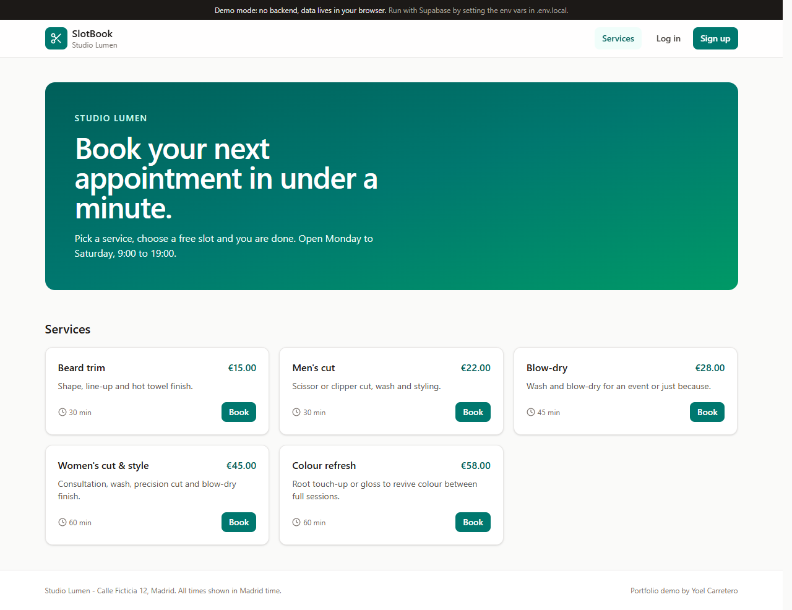
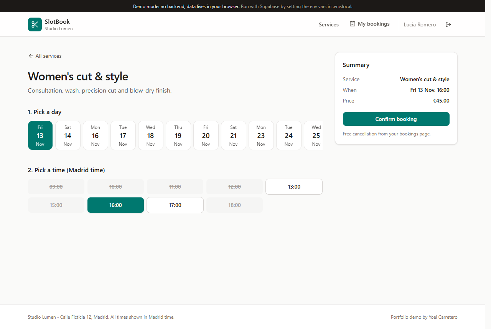
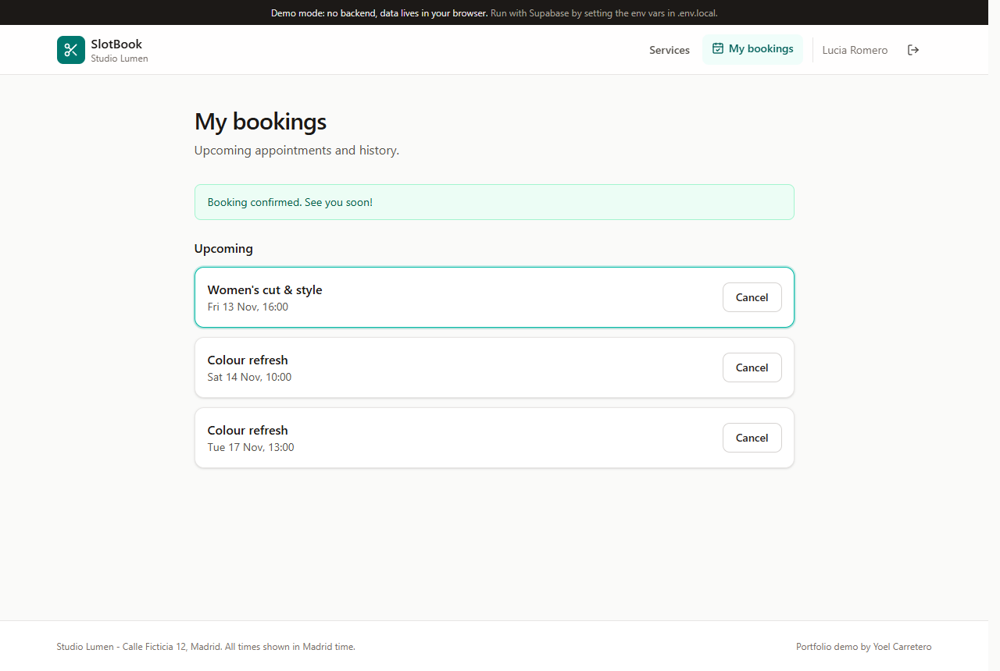
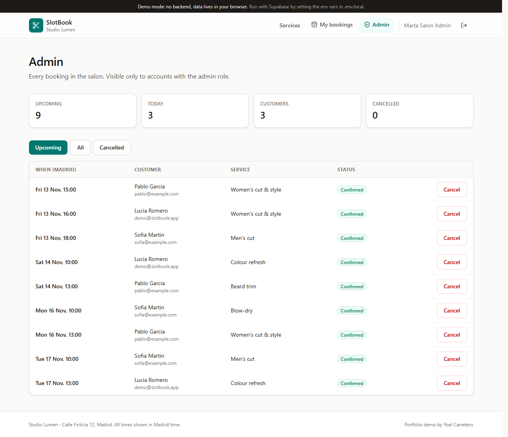
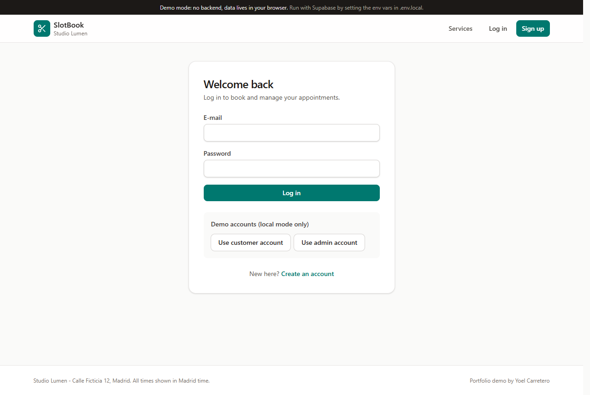
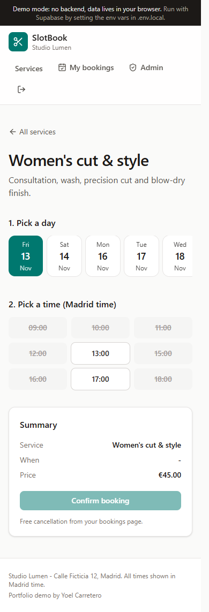

# SlotBook: rescuing an AI-built booking app

SlotBook is an appointment booking app for a (fictional) Madrid hair salon, Studio Lumen.
Customers sign up, pick a service and a free slot, and manage their bookings. The salon
owner gets an admin view with every appointment.

The interesting part is not the app itself, it is how it got here. This repository is a
portfolio case study of a very common situation: **a client built their app with Lovable
(or Bolt, or Base44), it looked finished, and then it broke in production.** I took that
app, found six real bugs, fixed them properly and added tests so they stay fixed.

> Built by **Yoel Carretero** as a demo for my Fiverr gig
> "I will fix, finish and deploy your Lovable, Bolt or Base44 app with Supabase".

## The story: a client's Lovable app with 6 production bugs

The brief was short: "Bookings app for my salon. Customers sometimes can't stay logged in,
and last week two people showed up for the same slot. Can you fix it and put it online?"

The UI was fine. The problems were underneath, and they are the same ones I see again and
again in AI-generated Supabase projects:

| # | What the client saw | What was actually wrong |
|---|---------------------|-------------------------|
| A | "A customer says she could see other people's bookings" | Row Level Security disabled on `bookings` |
| B | "Customers get logged out when they refresh" | Route guard ran before the session was restored; no `onAuthStateChange` |
| C | "Two people booked the same slot" | Availability checked in the browser only (race condition) |
| D | Nothing visible, found during the audit | The `service_role` key was in the frontend bundle |
| E | "Refreshing any page on the live site gives a 404" | No SPA rewrite on the static host |
| F | "Appointments show up an hour off" | Times stored as local strings instead of `timestamptz` |

Every bug, with the symptom, root cause, before and after code and how it was verified, is
written up in **[docs/BEFORE_AFTER.md](docs/BEFORE_AFTER.md)**.

## Screenshots

All screenshots are generated from the production build with Playwright
(`npm run screenshots`, see below), so they always match the code.

| Services | Booking a slot |
|----------|----------------|
|  |  |

| My bookings | Admin view |
|-------------|------------|
|  |  |

| Login (demo accounts) | Mobile |
|-----------------------|--------|
|  |  |

## Features

- Sign up, log in and log out with Supabase Auth; sessions survive refreshes and sync across tabs
- Service catalogue with prices and durations
- Booking flow: pick a day, see free and taken slots, confirm
- Double booking is impossible, even with simultaneous requests; the loser gets a friendly message
- "My bookings" with upcoming appointments, history and cancellation
- Admin view (role `admin`): every booking with customer details, filters and quick stats
- All times stored as UTC instants and displayed in salon time (Europe/Madrid), DST-safe
- **Two backends behind one interface**: real Supabase, or an offline `local` mode
  (localStorage + fake auth + seed data) so the demo runs anywhere with zero setup
- Responsive layout, accessible controls (labels, roles, focus states)

## Tech stack

| Layer | Choice |
|-------|--------|
| Frontend | React 18, TypeScript, Vite, React Router 7 |
| Styling | Tailwind CSS 4, lucide-react icons |
| Backend | Supabase (Postgres, Auth, Row Level Security, RPC) via `@supabase/supabase-js` |
| Tests | Vitest, Testing Library, jsdom; SQL checks against Postgres 17 in Docker |
| Tooling | Playwright (screenshots), Supabase CLI (local stack) |
| Hosting | Any static host: Vercel, Netlify, Cloudflare Pages |

This is the stack Lovable generates, on purpose: the point is to show how to fix such a
project, not to rewrite it in something else.

## How it is built

```
UI (pages, components)
        |  useData() / useAuth()
        v
DataLayer interface  ----------------------------.
        |                                         |
SupabaseDataLayer                          LocalDataLayer
(supabase-js, RLS, RPC)              (localStorage, same rules)
        |
Postgres: profiles, services, bookings
  + RLS policies, unique index, signup trigger
```

- `src/data/DataLayer.ts` defines what the UI needs (auth, services, bookings).
  Pages never import Supabase directly.
- `VITE_DATA_MODE` picks the implementation. If it is not set, the app uses Supabase when
  `VITE_SUPABASE_URL` and `VITE_SUPABASE_ANON_KEY` exist and falls back to `local` otherwise.
- The local layer enforces the same rules as the database (one booking per slot, users only
  see their own bookings, admin-only listing) so the demo behaves like production. It is a
  demo convenience, not a security boundary: the real protection is in the SQL.
- Slot logic (`src/lib/slots.ts`) is pure and fully unit-tested.

## Run it locally (no backend, 1 minute)

Requirements: Node 20+ (tested with Node 26) and npm.

```bash
npm install
npm run dev
```

Open http://localhost:5173. With no env vars the app starts in **local mode**, with a banner
saying so. Use the buttons on the login page to fill in a demo account:

| Role | E-mail | Password |
|------|--------|----------|
| Customer | demo@slotbook.app | demo1234 |
| Admin | admin@slotbook.app | admin1234 |

These accounts only exist in your browser's localStorage. To start from scratch, clear the
site data in DevTools (Application > Storage).

## Run it with Supabase

The schema lives in `supabase/migrations/` and the service catalogue in `supabase/seed.sql`.

### Option 1: local Supabase stack (Docker)

Requires Docker Desktop running. The CLI runs through `npx`, nothing is installed globally.

```bash
npx supabase start          # first run downloads the Supabase images, takes a few minutes
npx supabase db reset       # applies migrations + seed.sql
npx supabase status         # prints the API URL and the anon key
```

Create `.env.local`:

```bash
VITE_DATA_MODE=supabase
VITE_SUPABASE_URL=http://127.0.0.1:54321
VITE_SUPABASE_ANON_KEY=<anon key from "supabase status">
```

Then `npm run dev`, sign up in the app, and make yourself admin in Studio
(http://127.0.0.1:54323, SQL editor):

```sql
update public.profiles set role = 'admin' where email = 'you@example.com';
```

Log out and in again to see the Admin link. Stop the stack with `npx supabase stop`.

### Option 2: Supabase cloud project

1. Create a free project at [supabase.com](https://supabase.com).
2. In the SQL editor, run `supabase/migrations/20260101000000_initial_schema.sql`, then
   `supabase/seed.sql`. (Or link the CLI: `npx supabase link --project-ref <ref>` and
   `npx supabase db push`.)
3. In **Project Settings > API**, copy the Project URL and the **anon / publishable** key
   into `.env.local` as above. Never use the `service_role` / secret key in this app: it
   would be shipped to every visitor. The app refuses to start if you try.
4. In **Authentication > URL Configuration**, set the Site URL to your local or deployed URL
   so confirmation e-mails link back correctly.
5. Promote your account to admin with the SQL snippet above.

## Tests

```bash
npm test             # 47 unit and component tests (Vitest + Testing Library)
npm run build        # type-check (tsc) + production build
npm run verify:db    # applies the migration to Postgres 17 in Docker and runs RLS / race checks
```

What is covered:

- `src/lib/slots.test.ts`: slot generation, opening hours, lunch break, Sundays, DST,
  UTC/Madrid day boundaries, availability, server-side slot validation
- `src/data/localDataLayer.test.ts`: auth, session restore, double booking rejection,
  cancellation freeing a slot, per-user visibility, admin-only listing
- `src/data/supabaseDataLayer.test.ts`: Postgres error mapping (23505 to "slot taken")
- `src/data/config.test.ts`: data-mode selection and the service_role key guard
- `src/pages/BookPage.test.tsx` and `src/components/ProtectedRoute.test.tsx`: the booking
  flow, the lost-race message, and the "logged out on refresh" regression
- `scripts/verify-db.sh`: the real SQL against real Postgres, including two concurrent
  transactions racing for the same slot

## Screenshots: regenerate them

```bash
npm run build
npm run preview          # terminal 1, serves on http://localhost:4173
npm run screenshots      # terminal 2, writes docs/screenshots/*.png
```

The script uses an installed Microsoft Edge through Playwright, so no browser download is
needed. Use `PW_CHANNEL=chrome npm run screenshots` for Chrome.

## Deploy to Vercel

1. Push the repository to GitHub.
2. In Vercel, **Add New > Project** and import the repository. The Vite preset is detected
   automatically (build command `npm run build`, output directory `dist`).
3. Environment variables:
   - For a **static demo**: add nothing, or `VITE_DATA_MODE=local`. The app runs fully in
     the browser.
   - For **production**: `VITE_DATA_MODE=supabase`, `VITE_SUPABASE_URL`,
     `VITE_SUPABASE_ANON_KEY`.
4. Deploy. `vercel.json` rewrites every route to `index.html`, so refreshing `/bookings` or
   sharing `/book/<id>` works (bug E).
5. Add the Vercel URL to Supabase **Authentication > URL Configuration**.

Netlify and Cloudflare Pages work the same way; they use `public/_redirects` instead of
`vercel.json`.

## Project structure

```
src/
  data/          DataLayer interface, Supabase and local implementations, seed data
  lib/           slots and timezone logic, formatting, Supabase client + key guard, types
  context/       DataProvider and AuthProvider (session handling)
  components/    Layout, ProtectedRoute, SlotPicker, small UI kit
  pages/         Home, Book, My bookings, Admin, Login/Signup
supabase/
  migrations/    schema, RLS policies, unique index, trigger, RPC
  seed.sql       service catalogue
  config.toml    local Supabase CLI settings
scripts/
  verify-db.sh   SQL verification against Postgres in Docker
  screenshots.mjs
docs/
  BEFORE_AFTER.md
  screenshots/
vercel.json, public/_redirects   SPA rewrites
```

## About

I am Yoel Carretero, a developer from Spain studying multi-platform application development
(DAM). I help founders and small businesses take apps built with Lovable, Bolt
or Base44 from "almost works" to production: Supabase security and RLS, auth, data bugs,
deployment and handover documentation.

- E-mail: [yoelf.carretero@gmail.com](mailto:yoelf.carretero@gmail.com)
- GitHub: [github.com/yoelfcarretero-ui](https://github.com/yoelfcarretero-ui)

If you have an AI-built app that is misbehaving, send me the symptoms. Most of the time it is
one of the six problems above.

## License

MIT. Studio Lumen, its address and all people in the seed data are fictional.
