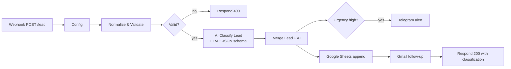
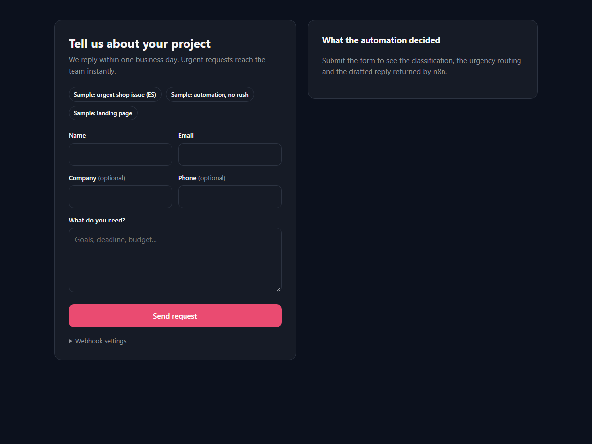

# n8n Lead Automation with AI

A small, production-shaped set of n8n workflows that turns a website contact form into a triaged sales pipeline, plus a morning inbox digest. Built as a portfolio demo: everything runs locally with Docker, and one workflow works end to end with zero accounts or API keys.

## The business problem

Small agencies and service businesses get leads from a contact form and handle them by hand: someone reads the email, guesses how urgent it is, copies it into a spreadsheet and writes a reply, usually hours later. Urgent requests ("our shop is down, we are losing sales") wait in the same queue as "maybe next quarter".

These workflows do that first pass in a couple of seconds:

- every lead is validated, classified by an LLM (category, urgency, budget estimate, one-line summary) and logged to Google Sheets;
- urgent leads ping the team on Telegram immediately;
- the lead gets a personalised first reply, drafted by the AI in their own language;
- every weekday at 08:00 the owner gets an inbox digest grouped by priority;
- if anything breaks, an error workflow reports exactly which node failed, with a link to the run.

## What is in the box

```
.
├── docker-compose.yml          n8n 2.47.7 (pinned), persistent volume, Europe/Madrid
├── .env.example                basic settings, no secrets
├── workflows/
│   ├── lead-capture-ai.json        Webhook -> validate -> LLM triage -> Telegram / Sheets / Gmail -> response
│   ├── error-notifier.json         Error Trigger -> Telegram + email
│   ├── daily-inbox-digest.json     Schedule -> Gmail last 24h -> LLM digest -> email + Telegram
│   └── lead-capture-mock.json      Same contract as the AI flow, no credentials needed
├── form/index.html             static lead form (no framework) that shows the AI result
├── scripts/
│   ├── send-test-leads.mjs         posts 3 sample leads + 1 invalid one and prints the results
│   └── validate-workflows.mjs      structural checks for the workflow exports
└── docs/
    ├── architecture.md             Mermaid diagram and design notes for every workflow
    └── client-handover-guide.md    template handed to the client at delivery
```

## The workflows

### 1. Lead Capture with AI Triage (`lead-capture-ai.json`)



- **Webhook** receives `{name, email, company, phone, message}` and answers at the end with the classification, so the form can show it.
- **Normalize & Validate** (Code node) trims and lowercases fields, validates the email, rejects spam through a honeypot field and assigns a lead id. Invalid requests get a 400 before any paid API call is made.
- **AI Classify Lead** is a Basic LLM Chain with the OpenAI Chat Model and a **Structured Output Parser**. The JSON schema forces `category` and `urgency` into fixed enums, so the IF node downstream can trust them. The step retries 3 times.
- **Telegram alert** only fires for `urgency = high`. **Google Sheets** keeps the lead log. **Gmail** sends the AI-drafted reply.
- Notifications are set to *continue on error*, so a Telegram outage never loses a lead. Hard failures go to the **Error Notifier** workflow (set in the workflow settings).

### 2. Daily Inbox Digest (`daily-inbox-digest.json`)

Schedule (Mon-Fri 08:00, Europe/Madrid) -> Gmail "get many" for the last 24 hours (inbox only, promotions and social excluded) -> one Code node compacts all emails into a single prompt -> Anthropic model returns `{headline, high[], medium[], low[]}` through a structured parser -> rendered as an HTML email and a Telegram message. One LLM call per day, and only sender, subject and snippet leave the mailbox.

### 3. Error Notifier (`error-notifier.json`)

Error Trigger -> format a readable message (workflow, failing node, error, execution link) -> Telegram and email.

### 4. Lead Capture Mock (`lead-capture-mock.json`)

The same request and response contract as workflow 1, with every external service replaced:

| Real workflow | Mock |
|---|---|
| OpenAI classification | Deterministic keyword classifier in a Code node (same JSON schema, replies in Spanish or English) |
| Google Sheets | Workflow static data, readable at `GET /webhook/lead-demo/leads` |
| Telegram, Gmail | Previews returned in the response |

That makes the full demo runnable in a few minutes, and switching to the real workflow is a URL change.

Full diagrams for all four are in [docs/architecture.md](docs/architecture.md).

## Run it locally in 5 minutes

Requirements: Docker Desktop and Node.js 18+.

```bash
# 1. Start n8n (optional: cp .env.example .env and adjust)
docker compose up -d

# 2. Import all workflows with the n8n CLI
#    (Git Bash on Windows: prefix with MSYS_NO_PATHCONV=1 so /workflows is not rewritten)
docker compose exec n8n n8n import:workflow --separate --input=/workflows

# 3. Publish (activate) the mock workflow and restart so the webhook is registered
docker compose exec n8n n8n publish:workflow --id=LeadCaptureMock1
docker compose restart n8n

# 4. Send the sample leads
node scripts/send-test-leads.mjs
```

Then open `form/index.html` in a browser and submit one of the sample leads. The webhook URL is under "Webhook settings" on the form (or pass `?webhook=` in the page URL).

The editor is at http://localhost:5678. The first visit asks you to create the local owner account.

To stop: `docker compose down` (add `-v` to also delete the n8n data volume).

### Verified output

This is the actual output of `node scripts/send-test-leads.mjs` against the mock workflow on n8n 2.47.7:

```
[200] Laura Martinez (463 ms)
  category:  ecommerce
  urgency:   high
  budget:    800 EUR (stated)
  reply:     Hola Laura, gracias por escribirnos. Hemos leído tu mensaje sobre vuestra tienda online y ...

[200] James Carter (137 ms)
  category:  automation
  urgency:   low
  budget:    500-2500 EUR

[200] Sofia Rossi (134 ms)
  category:  web_development
  urgency:   medium
  budget:    1500 USD (stated)

[400] invalid payload -> {"ok":false,"errors":["name is required","email is invalid","message must be at least 10 characters"]}

All checks passed.
```

### Running the AI workflow

1. In the editor, create the credentials listed below with exactly these names.
2. Open **Lead Capture with AI Triage**, edit the **Config** node (business name, Telegram chat id, Google Sheet id) and select the credential on any node that shows a warning.
3. Create the Google Sheet with a `Leads` tab whose first row is: `Lead ID, Received At, Name, Email, Company, Phone, Source, Category, Urgency, Budget Estimate, Summary, Message`.
4. Publish, then run `node scripts/send-test-leads.mjs http://localhost:5678/webhook/lead`.

### Validating the exports

```bash
node scripts/validate-workflows.mjs
```

Checks that every file parses, every node has `id`, `name`, `type`, `typeVersion` and `position`, names and ids are unique, every connection points to an existing node, nothing is left unconnected, no API key is embedded, and every `errorWorkflow` reference resolves.

## Importing into n8n Cloud

1. In your n8n Cloud workspace: **Create workflow**, then the `...` menu > **Import from File**, and pick a JSON file from `workflows/`. Repeat per file (import `error-notifier.json` first).
2. UI imports get new workflow ids, so open each workflow's **Settings > Error workflow** and select "Error Notifier" again.
3. Create the credentials (Google and Gmail OAuth are one click on Cloud), fill in the Config nodes and click **Publish**.
4. Your webhook URL is shown on the Webhook node, under "Production URL".

## Credentials needed

| Credential name | Type in n8n | Used by |
|---|---|---|
| `OpenAI account` | OpenAI API | Lead triage |
| `Anthropic account` | Anthropic API | Inbox digest |
| `Telegram account` | Telegram API (bot token from @BotFather) | Urgent-lead alerts, digest, error alerts |
| `Google Sheets account` | Google Sheets OAuth2 | Lead log |
| `Gmail account` | Gmail OAuth2 | Follow-up email, digest, error alerts |

The exports reference credentials by name only. No keys are stored in this repository.

Models are set to `gpt-4.1-mini` (lead triage) and `claude-opus-5-5` (digest). Both are a dropdown in the model node; pick whatever fits the client's budget and check the result on a handful of real examples after switching.

## Cost notes

- **n8n**: the self-hosted Community Edition is free; a small VPS that runs it comfortably costs roughly 5-10 EUR per month. n8n Cloud is a monthly subscription billed by executions; see n8n.io/pricing. Each lead is one execution and the digest is one per weekday.
- **Lead triage**: one LLM call per lead, around 700 input and 250 output tokens. With a small model that is a fraction of a cent per lead.
- **Inbox digest**: one call per weekday with up to 60 compacted emails (roughly 5-8k input tokens). On Claude Opus 5.5 ($4 / $20 per million input / output tokens) that is a few cents per day; a smaller model such as Claude Haiku 5.5 brings it well under a cent.
- Telegram, Gmail and Google Sheets APIs are free at this volume.
- Set a monthly spend limit in the OpenAI and Anthropic dashboards before going live.

Prices change. Check the providers' pricing pages when quoting a client.

## Screenshots

The lead form (`form/index.html`, dark mode):



Screenshots of the n8n editor are not included yet. To capture them:

1. Run the quick start above, open http://localhost:5678 and create the local owner account.
2. **Editor view**: open each workflow, press `Shift+1` (zoom to fit), hide the side panel, and take a 1600x900 screenshot. Save as `docs/screenshots/lead-capture-ai.png`, `daily-inbox-digest.png`, `lead-capture-mock.png`.
3. **Execution view**: run `node scripts/send-test-leads.mjs`, open **Executions** in the mock workflow, click the Laura Martinez run (urgent lead, green path through "Notify Team") and capture it as `docs/screenshots/execution-urgent-lead.png`.
4. **Form**: open `form/index.html`, click "Sample: urgent shop issue (ES)", submit, and capture the page with the result card as `docs/screenshots/form-result.png`.
5. **Node detail**: open **AI Classify Lead** to show the prompt and the structured output parser side by side as `docs/screenshots/ai-node.png`.

<!-- Once captured, uncomment:


-->

## What was verified

- All four workflows import cleanly with `n8n import:workflow --separate` on n8n 2.47.7, and every node type and `typeVersion` exists in that release.
- The mock workflow was published and tested end to end through its production webhook: three leads classified correctly, the invalid payload rejected with a 400, leads persisted and listed through the GET endpoint, CORS headers present for the browser form.
- The AI, Telegram, Google Sheets and Gmail steps were not executed, because they need real accounts. They are configured against the current node parameters but should be tested once credentials are connected.

## Author

**Yoel Carretero** - automation and AI workflows with n8n

- Email: yoelf.carretero@gmail.com
- GitHub: [yoelfcarretero-ui](https://github.com/yoelfcarretero-ui)

If you want something like this for your business (lead routing, inbox triage, CRM sync, AI-written replies), get in touch.
