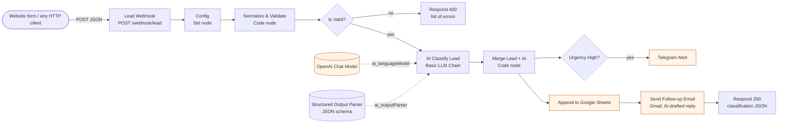
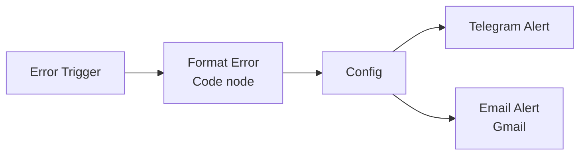
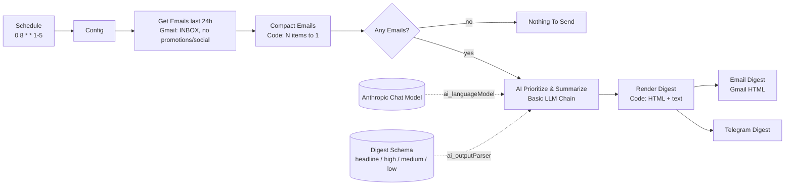
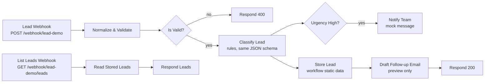

# Architecture

Four workflows, all exported from n8n 2.47.7 and stored in `workflows/`.

| File | Workflow name | Trigger | External services |
|---|---|---|---|
| `lead-capture-ai.json` | Lead Capture with AI Triage | Webhook `POST /webhook/lead` | OpenAI, Telegram, Google Sheets, Gmail |
| `error-notifier.json` | Error Notifier | Error Trigger (any workflow that selects it) | Telegram, Gmail |
| `daily-inbox-digest.json` | Daily Inbox Digest (AI) | Schedule, Mon-Fri 08:00 Europe/Madrid | Gmail, Anthropic, Telegram |
| `lead-capture-mock.json` | Lead Capture (Mock, no credentials) | Webhook `POST /webhook/lead-demo`, `GET /webhook/lead-demo/leads` | none |

## 1. Lead Capture with AI Triage

Design decisions:

- **Respond to Webhook at the end** so the form can show the AI result. Validation errors return a 400 immediately, before any paid API call.
- **Structured Output Parser** with a JSON schema (enums for `category` and `urgency`) makes the LLM output machine-readable. The chain retries up to 3 times.
- **Config node** holds every client-specific value (Telegram chat id, Sheet id, business name), so nothing is hard-coded in the other nodes.
- **Telegram and Gmail use "continue on error"**: a failed notification must not lose the lead. Google Sheets retries 3 times and, if it still fails, stops the run and the Error Notifier fires.
- **Settings > Error workflow** points to `Error Notifier`.

## 2. Error Notifier

Any workflow whose settings select "Error Notifier" as its error workflow sends the workflow name, failing node, error message and a direct link to the execution.

## 3. Daily Inbox Digest (AI)

Design decisions:

- Only sender, subject and Gmail's snippet go to the model, which keeps cost low and avoids sending full email bodies to a third party.
- All emails are compacted into **one** item, so there is one LLM call per day instead of one per email.
- `alwaysOutputData` on the Gmail node plus the `Any Emails?` check means an empty inbox ends cleanly instead of erroring.

## 4. Lead Capture (Mock)

Same contract as the AI workflow (same request body, same response shape), so the form and the test script work against either one. Swapping the mock for the real workflow is a URL change.
