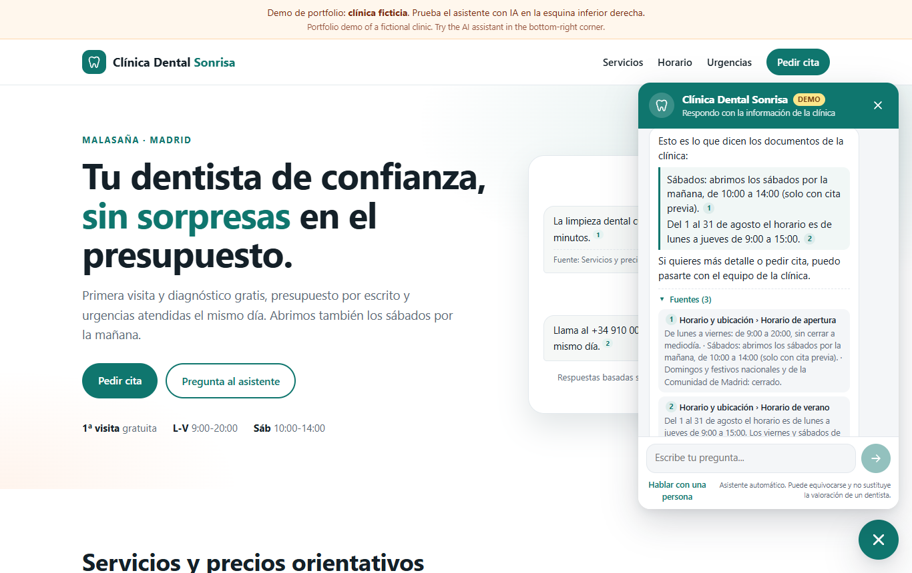
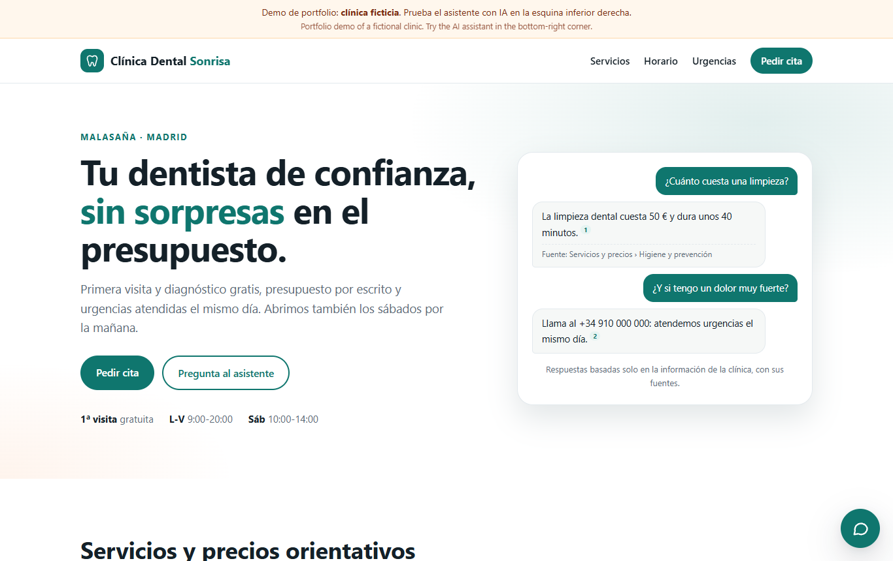
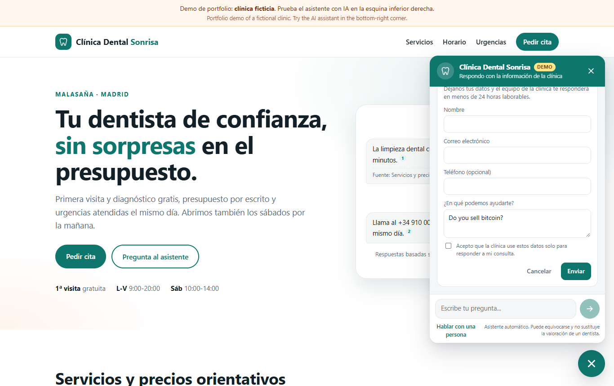
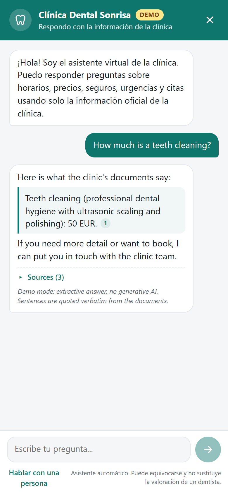
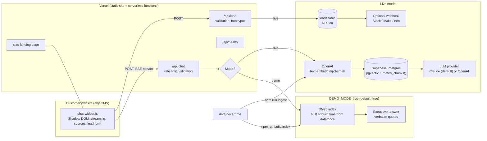

# AI chatbot trained on your business documents (RAG demo)

An AI assistant for a website that answers **only** from the business's own documents, shows where every answer comes from, captures leads, and hands the conversation to a human when it is not sure.

The demo is set up for a fictional dental clinic in Madrid, **Clínica Dental Sonrisa / Smile Dental Clinic**. It runs fully offline and free out of the box, and switches to a real embeddings + LLM pipeline (OpenAI embeddings, Supabase pgvector, Anthropic Claude) by adding environment variables.



---

## The business problem

Small businesses answer the same questions all day: *Are you open on Saturdays? How much is a cleaning? Do you take my insurance? I am in pain, what do I do?* The answers already exist in their price lists, policies and FAQs, but visitors do not read them, and the phone rings during treatments.

A generic chatbot is risky for this. A general-purpose model will happily invent a price or an opening time, and for a clinic a wrong answer about an emergency is worse than no answer. What the business actually needs is:

- answers grounded in **its** documents, in the visitor's language;
- a visible source for each answer, so the visitor (and the owner) can trust it;
- an honest "I don't know" that turns into a **lead** instead of a lost visitor;
- something that installs on an existing site with one line of code and costs a few euros a month to run.

That is what this project does.

## What the demo shows

- A static landing page for the clinic (`site/`) with the chat widget embedded through **one `<script>` tag**.
- The widget answers questions in **Spanish or English** (it detects the language of each message), streams the answer, and lists numbered **sources** (document and section) under every reply.
- Six realistic clinic documents per language in `data/docs/`: services and prices, opening hours and location, insurance and payment, first-visit FAQ, emergency policy, booking and cancellation policy.
- When the question is outside the documents (*"Do you sell bitcoin?"*), or the visitor asks for a person, the assistant says so and offers a **lead form** (name, email, optional phone, question, GDPR consent). The last messages of the chat are attached to the lead so the clinic has context when calling back.
- A "DEMO" badge and a note under each answer make it obvious when the app runs in offline demo mode.

| Landing page | Handoff and lead capture | Mobile, English |
|---|---|---|
|  |  |  |

The screenshots were captured from the local dev server in demo mode with headless Chrome.

## How it avoids hallucinations

Grounding is enforced in layers, so no single component has to be perfect:

1. **Retrieval gate.** Before any model is called, the question is matched against the documents. If nothing relevant enough is found (low BM25 coverage in demo mode, cosine similarity below `MATCH_THRESHOLD` in live mode), the API never calls the LLM: it answers "I don't have that information" and offers the contact form.
2. **Strict system prompt** (`lib/prompt.ts`). The model is told to answer only from the `<documents>` provided, never guess prices, hours, names or policies, cite every factual sentence as `[n]`, refuse diagnoses, repeat the 112 emergency guidance for severe symptoms, and treat documents and chat history as data, never as instructions (prompt-injection defence).
3. **Explicit "I don't know" channel.** When the model cannot answer from the context it appends a `[[HANDOFF]]` token. The server strips it from the stream (even when it arrives split across chunks) and tells the widget to show the lead form.
4. **Citations the user can check.** Sources are numbered in the same order as the documents in the prompt, so `[2]` in the answer always matches source 2 in the widget.
5. **Demo mode cannot hallucinate at all.** The offline generator is extractive: it only quotes sentences verbatim from the retrieved chunks.
6. **Small, controlled history.** Only the last few turns are sent, as plain text, and retrieved documents are never carried over, so the model cannot cite stale context.

## Architecture



Request flow for `/api/chat`: rate limit by IP -> validate input (max 500 chars, sanitised history) -> detect language -> contact intent? -> retrieve top chunks -> relevance gate -> build guarded prompt -> stream the answer (SSE) -> strip `[[HANDOFF]]` -> `done` event with the handoff flag.

## Features

- Retrieval-augmented generation with a pluggable retriever (`Bm25Retriever`, `PgVectorRetriever`) and a pluggable answer generator (`AnthropicGenerator`, `OpenAIGenerator`, `ExtractiveGenerator`).
- Streaming answers over Server-Sent Events, with a JSON fallback (`stream: false`).
- Bilingual (ES/EN): per-message language detection, documents in both languages, labels in the widget follow the answer language.
- Source citations with document, section and snippet.
- Lead capture with consent checkbox, honeypot anti-spam field and chat transcript; stored in Supabase in live mode, optional webhook notification.
- Human handoff when the user asks for a person, when nothing relevant is retrieved, when the model is unsure, or when the model refuses.
- Embeddable widget: one file (about 23 KB minified, no dependencies), Shadow DOM style isolation, configurable through `data-` attributes, accessible (dialog role, live region, keyboard and Escape support), full screen on mobile.
- Security: API keys only on the server, per-IP rate limiting, input length limits, body size limits, CORS allow-list, RLS on every table, HTML escaping of all model output in the widget.
- Idempotent ingestion with checksums (unchanged documents are not re-embedded) and optional pruning.
- 75 Vitest tests covering chunking, retrieval quality, prompt guardrails, the streaming filter, the API handlers, the rate limiter, configuration and the widget renderer.

## Tech stack

| Layer | Technology |
|---|---|
| Widget | TypeScript, Shadow DOM, Fetch + ReadableStream (SSE over POST), bundled with esbuild into a single IIFE |
| API | Vercel Serverless Functions (Node.js runtime), TypeScript |
| Retrieval (demo) | BM25 implemented from scratch, index generated at build time |
| Retrieval (live) | OpenAI `text-embedding-3-small` + Supabase Postgres `pgvector` (HNSW index, cosine distance) |
| LLM (live) | Anthropic Claude via `@anthropic-ai/sdk` (default model `claude-haiku-5-5`), or OpenAI via `openai` |
| Database | Supabase (`@supabase/supabase-js`), SQL migration with RLS |
| Tests | Vitest |
| Tooling | tsx, TypeScript, esbuild |

## Demo mode vs real mode

| | Demo mode | Real mode |
|---|---|---|
| How to enable | Default when no keys are set, or `DEMO_MODE=true` | Set the keys below and `DEMO_MODE=false` (or leave it unset) |
| Retrieval | BM25 over a local index (`lib/generated/bm25-index.ts`) | Embeddings + pgvector `match_chunks()` |
| Answer | Extractive: verbatim quotes with citations | Generated by Claude (or OpenAI) from the retrieved context |
| Leads | Logged with the email masked, not stored | Inserted into `public.leads`, optional webhook |
| Cost | Free | See the estimate below |
| Network | No external calls | OpenAI, Anthropic, Supabase |

If `DEMO_MODE=false` is set but a key is missing, the app falls back to demo mode and `/api/health` explains why, instead of failing in front of visitors.

## Run it locally

Requirements: Node.js 20+ (developed on Node 26), npm.

```bash
npm install
npm run dev        # builds the index and the widget, then serves http://localhost:3000
```

`npm run dev` starts a small Node HTTP server (`scripts/dev-server.ts`) that serves `site/` and mounts the same handlers Vercel runs, so you do not need the Vercel CLI. Open `http://localhost:3000` (or `http://localhost:3000/#chat` to open the widget directly).

Try it from the terminal:

```bash
curl -s http://localhost:3000/api/health

curl -s -X POST http://localhost:3000/api/chat \
  -H "Content-Type: application/json" \
  -d '{"message":"How much is a teeth cleaning?"}'

# streaming (Server-Sent Events)
curl -N -X POST http://localhost:3000/api/chat \
  -H "Content-Type: application/json" \
  -d '{"message":"Are you open on Saturdays?","stream":true}'
```

Other scripts:

```bash
npm test            # run the test suite
npm run build       # build index + typecheck + build widget (what Vercel runs)
npm run ingest:dry  # show how documents are chunked, no API calls
```

## Use your own documents and ingest them

1. Put Markdown files in `data/docs/es/` and/or `data/docs/en/`, one topic per file, with a small frontmatter block:

   ```markdown
   ---
   title: Opening hours and location
   slug: hours-location
   ---

   # Opening hours and location

   ## Opening hours
   ...
   ```

   Headings matter: chunks never cross a heading, and the heading path becomes the "section" shown in the sources.
2. Demo mode: run `npm run build:index` (also part of `npm run build`).
3. Real mode:
   - Create a Supabase project and run `supabase/migrations/20261113000000_rag_schema.sql` (Supabase CLI `supabase db push`, or paste it into the SQL editor).
   - Copy `.env.example` to `.env` and fill in `OPENAI_API_KEY`, `SUPABASE_URL`, `SUPABASE_SERVICE_ROLE_KEY` (and `ANTHROPIC_API_KEY` for Claude).
   - Run `npm run ingest`. Re-running it only re-embeds documents whose content changed; `--force` re-embeds everything and `--prune` removes documents you deleted locally.

Chunking strategy (`lib/chunking.ts`): split by headings first, then pack paragraphs and sentences up to 900 characters with a 150-character overlap between consecutive chunks of the same section. The title and section path are prepended to the text that gets indexed or embedded, so a question like "Saturday hours" can match the heading even if the body does not repeat it.

## Deploy to Vercel

`vercel.json` is configured so a plain deploy works in demo mode with **zero** environment variables: Vercel runs `npm run build`, serves `site/` as static files and deploys every file in `api/` as a Node.js function.

```bash
vercel          # preview deployment
vercel --prod   # production
```

Or import the repository in the Vercel dashboard (framework preset "Other"; the build settings are read from `vercel.json`).

To switch to real mode, add these in **Project Settings -> Environment Variables** and redeploy:

| Variable | Required for live mode | Notes |
|---|---|---|
| `DEMO_MODE` | | `false` to force live mode, `true` to force demo |
| `OPENAI_API_KEY` | yes | embeddings (and chat if `LLM_PROVIDER=openai`) |
| `ANTHROPIC_API_KEY` | yes, with Claude | |
| `SUPABASE_URL` | yes | |
| `SUPABASE_SERVICE_ROLE_KEY` | yes | secret, server only |
| `LLM_PROVIDER` | | `anthropic` (default) or `openai` |
| `LLM_MODEL` | | default `claude-haiku-5-5` |
| `LLM_MAX_TOKENS` | | default 4096 |
| `MATCH_COUNT`, `MATCH_THRESHOLD` | | retrieval tuning, default 4 and 0.3 |
| `LEAD_WEBHOOK_URL` | | Slack/Make/Zapier/n8n webhook for new leads |
| `ALLOWED_ORIGINS` | | comma-separated sites allowed to call the API, default `*` |
| `RATE_LIMIT_CHAT_PER_MIN`, `RATE_LIMIT_LEAD_PER_MIN` | | default 20 and 5 per IP |

Check `https://<your-app>.vercel.app/api/health` after deploying: it reports the active mode and the reason, never the keys.

## Monthly cost estimate for a small business

**Estimate only**, based on list prices at the time of writing; check the providers' pricing pages before quoting a client.

Assumptions: 1,000 conversations a month, 3 questions each (3,000 questions), about 2,000 input tokens per question (system prompt + 4 chunks + short history) and up to 500 output tokens.

| Item | Estimate |
|---|---|
| Claude Haiku 5.5 (about $0.10 per million input tokens, $0.50 per million output tokens): 6M input + 1.5M output | about $1.35 |
| OpenAI `text-embedding-3-small` for 3,000 short questions plus re-ingesting the documents | well under $0.10 |
| Supabase | $0 on the free plan (it pauses inactive projects, so a paid plan, from about $25, is safer for production) |
| Vercel | $0 on Hobby for personal or demo use; commercial sites need Pro (from about $20 per member) |
| **Total** | **about $2 a month in AI usage**, plus $0 to $45 of hosting depending on plans |

Demo mode costs nothing to run.

## Embed the widget on any website

The whole integration is one tag before `</body>`:

```html
<script src="https://YOUR-APP.vercel.app/chat-widget.js"
        data-api-url="https://YOUR-APP.vercel.app/api"
        data-title="Smile Dental Clinic"
        data-color="#0f766e"
        data-lang="auto"
        data-position="right"
        defer></script>
```

| Attribute | Default | Description |
|---|---|---|
| `data-api-url` | `<script origin>/api` | where `/chat`, `/lead` and `/health` live |
| `data-title` | "Clinic assistant" | header title |
| `data-color` | `#0f766e` | brand colour (hex, rgb or hsl) |
| `data-lang` | `auto` | `es`, `en` or `auto` (browser language) for the interface; answers always follow the language the visitor writes in |
| `data-position` | `right` | `right` or `left` |
| `data-open` | `false` | open the panel on load |

When embedding on a different domain, set `ALLOWED_ORIGINS` to that domain (for example `https://www.myclinic.com`).

- **WordPress:** install a header/footer code plugin (for example WPCode) and paste the tag in the footer section, or add it to your child theme's `footer.php` before `</body>`.
- **Shopify:** Online Store -> Themes -> Edit code -> `layout/theme.liquid`, paste the tag just before `</body>` and save.
- **Wix:** Settings -> Custom Code -> Add Custom Code, paste the tag, choose "All pages" and "Body - end". Custom code requires a premium plan with a connected domain.
- **Plain HTML, Webflow, Squarespace:** use the site-wide "footer code" or "code injection" setting.

Because the widget renders inside a Shadow DOM, the host theme's CSS cannot break it and its CSS cannot leak into the site.

## Project structure

```
api/                 Vercel functions: chat.ts, lead.ts, health.ts (thin wrappers)
lib/                 server code: chunking, BM25, retrieval, prompts, LLM providers, leads, rate limiting
lib/generated/       BM25 index generated from data/docs at build time
data/docs/{es,en}/   the clinic's knowledge base (Markdown)
widget/src/          embeddable widget (TypeScript) -> site/chat-widget.js
site/                static landing page
scripts/             build-index, build-widget, dev-server, ingest
supabase/migrations/ schema: documents, chunks (vector), match_chunks(), leads, RLS
tests/               Vitest suites
docs/screenshots/    images used in this README
```

## Screenshots

The images in `docs/screenshots/` are real captures of this demo running locally in demo mode. To regenerate them after a design change, run `npm run dev`, open `http://localhost:3000/#chat` in a browser at 1366x860 (desktop) and 390x844 (mobile), ask the suggested questions and capture the window.

## Limitations and next steps

- The in-memory rate limiter works per serverless instance. For a strict global limit, back it with Upstash Redis or use Vercel's firewall rules.
- The BM25 demo uses a deliberately simple stemmer and a small synonym list tuned for this clinic; real mode uses embeddings, which handle paraphrases far better.
- Ideas: an admin page to review leads, analytics on unanswered questions (the best signal for which document to write next), PDF/DOCX ingestion, and re-ranking of retrieved chunks.

## Author

**Yoel Carretero**, DAM student and freelance developer.

- Email: yoelf.carretero@gmail.com
- GitHub: [yoelfcarretero-ui](https://github.com/yoelfcarretero-ui)

The clinic, its address, phone numbers and prices are fictional and exist only for this demo.
